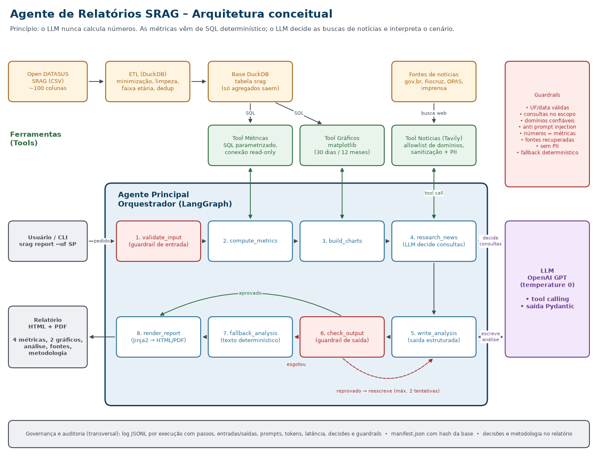

# Agente de Relatórios de SRAG (PoC – Indicium HealthCare)

Solução de IA Generativa que consulta a base de **Síndrome Respiratória Aguda Grave (SRAG)** do
Open DATASUS, calcula métricas epidemiológicas, busca **notícias em tempo real** e gera
automaticamente um relatório (HTML + PDF) com métricas, gráficos e uma análise explicativa.

| Entregável | Onde |
|---|---|
| Diagrama conceitual da arquitetura (PDF) | [`docs/arquitetura.pdf`](docs/arquitetura.pdf) (PNG: [`docs/arquitetura.png`](docs/arquitetura.png)) |
| Relatório de exemplo (dados reais) | [`reports/exemplo/relatorio.pdf`](reports/exemplo/relatorio.pdf) · [`relatorio.html`](reports/exemplo/relatorio.html) |
| Trilha de auditoria do exemplo | [`reports/exemplo/auditoria.jsonl`](reports/exemplo/auditoria.jsonl) · [`manifest.json`](reports/exemplo/manifest.json) |
| Código | [`src/srag/`](src/srag) |
| Testes | [`tests/`](tests) |

> O relatório de exemplo foi gerado com `srag report` sobre a **base real do DATASUS**
> (arquivos `INFLUD25` e `INFLUD26` de 23/11/2026, 589.437 casos), com análise do `gpt-4o-mini` e
> notícias buscadas pela Tavily. Só agregados e o log de auditoria são versionados; os microdados
> ficam fora do repositório. A trilha de auditoria mostra cada prompt, cada resposta, as buscas
> escolhidas pelo LLM e o resultado dos guardrails dessa execução.

---

## 1. Arquitetura



O **Agente Principal (Orquestrador)** é um `StateGraph` do **LangGraph** com estado tipado. Cada nó
tem uma responsabilidade única e registra tudo na trilha de auditoria:

| # | Nó | O que faz | Usa LLM? |
|---|---|---|---|
| 1 | `validate_input` | Guardrail de entrada: UF válida, data dentro da base | não |
| 2 | `compute_metrics` | **Tool Métricas**: SQL parametrizado (DuckDB read-only) | não |
| 3 | `build_charts` | **Tool Gráficos**: 30 dias (diário) e 12 meses (mensal) | não |
| 4 | `research_news` | O LLM decide **quais consultas** fazer (tool calling) na **Tool Notícias** (Tavily) | sim |
| 5 | `write_analysis` | O LLM escreve a análise em **saída estruturada** (Pydantic) | sim |
| 6 | `check_output` | Guardrail de saída: números, fontes, PII, completude | não |
| 7 | `fallback_analysis` | Texto determinístico se o LLM for reprovado 2 vezes | não |
| 8 | `render_report` | Jinja2 → HTML autocontido + PDF | não |

`check_output` tem uma aresta condicional: **aprovado** → `render_report`; **reprovado** → volta a
`write_analysis` com os problemas encontrados como feedback; **reprovado de novo** →
`fallback_analysis`. O relatório sempre sai, e sempre com números corretos.

### Decisões de arquitetura

- **O LLM nunca calcula números.** LLMs erram aritmética e alucinam valores. As métricas são
  calculadas por SQL determinístico e testado; o LLM recebe só os agregados e os interpreta. O
  guardrail de saída confere que todo percentual citado existe nas métricas ou nas notícias.
- **Grafo explícito (LangGraph) em vez de um agente ReAct livre.** Um relatório tem etapas
  obrigatórias e fixas: métricas, gráficos e verificação não podem ser "esquecidos" pelo modelo.
  A autonomia do LLM fica onde ela agrega valor: escolher as buscas de notícias e redigir a
  análise. O fluxo fica previsível, auditável e testável.
- **DuckDB** como banco analítico embarcado: lê o CSV bruto direto, faz o ETL em SQL, não exige
  servidor e oferece conexão `read_only`.
- **Tavily** para notícias: API de busca feita para agentes, com filtro por domínio e por data. Usa a
  busca geral com janela de um mês, porque o modo `news` com filtro de domínios não retorna resultados.
- **Injeção de dependências** (`AgentDeps`): LLM, ferramenta de notícias e repositório são
  injetados no grafo. Isso permite o modo `--offline` e testes sem chamadas externas.

## 2. Dados e tratamento

Fonte: [Open DATASUS – SRAG](https://opendatasus.saude.gov.br/dataset/srag-2021-a-2024)
(arquivos `INFLUDxx-*.csv`, separador `;`, codificação latin-1). Dicionário de dados:
[link](https://opendatasus.saude.gov.br/dataset/srag-2021-a-2024/resource/3135ac9c-2019-4989-a893-2ed50ebd8e68).

ETL em [`src/srag/data/etl.py`](src/srag/data/etl.py):

| Coluna original | Coluna tratada | Tratamento |
|---|---|---|
| `DT_SIN_PRI` | `dt_sintomas` | data de referência dos casos; aceita `dd/mm/aaaa` e `aaaa-mm-dd` |
| `DT_NOTIFIC` | `dt_notificacao` | usada para descartar sintomas posteriores à notificação |
| `SG_UF_NOT` | `uf` | maiúsculas, sem espaços |
| `EVOLUCAO` | `evolucao` | 1 cura, 2 óbito, 3 óbito outras causas; **9 → NULL** |
| `UTI` | `uti` | 1 sim, 2 não; **9 → NULL** |
| `VACINA_COV` / `VACINA` | `vacina_covid` / `vacina_gripe` | 1 sim, 2 não; **9 → NULL** |
| `HOSPITAL`, `CLASSI_FIN`, `CS_SEXO` | idem | códigos inválidos → NULL |
| `NU_IDADE_N` + `TP_IDADE` | `faixa_etaria` | **idade exata descartada**: só `0-4`, `5-19`, `20-59`, `60+` |

Os arquivos antigos vêm em latin-1 com datas `dd/mm/aaaa`; os atuais (2025–2026), em UTF-8 com
datas ISO (`2025-05-15T00:00:00.000Z`). O ETL detecta a codificação de cada arquivo e aceita os dois
formatos de data, então dá para carregar anos diferentes juntos.

Regras de qualidade:

- Datas inválidas (ex.: `31/02`), anteriores a 2019, futuras, ou sintomas após a notificação são descartados.
- Duplicatas são removidas comparando a **linha bruta inteira**, para nunca juntar pacientes
  diferentes que coincidem nas colunas selecionadas.
- Códigos "ignorado" viram `NULL`, então **saem do denominador**. O relatório mostra a
  **cobertura** (fração de casos com a informação preenchida) de cada métrica.

## 3. Métricas

Janela padrão: últimos 30 dias até a data de referência. Por padrão, a data de referência é a
**última data da base menos 14 dias**: as notificações chegam com atraso, e as semanas mais recentes
ficam incompletas. Na base real de nov/2026, a última semana tinha cerca de 15% dos casos de uma
semana normal, o que produziria uma "queda" falsa de quase 80%. Use `--ref-date` para escolher
outra data.

| Métrica | Definição | Observação |
|---|---|---|
| **Taxa de aumento de casos** | (casos últimos 7 dias − 7 dias anteriores) / 7 dias anteriores | Atraso de notificação tende a subestimar a semana mais recente |
| **Taxa de mortalidade** | óbitos por SRAG / casos com desfecho conhecido | Letalidade entre casos notificados, não da população |
| **Taxa de ocupação de UTI** | casos em UTI / casos com UTI informado | **Proxy**: a base não traz capacidade de leitos (exigiria CNES) |
| **Taxa de vacinação** | casos vacinados contra COVID-19 / casos com a informação | **Proxy**: vacinação entre os casos, não cobertura populacional (exigiria SI-PNI) |

Taxas com denominador menor que 5 não são exibidas (`n/d`), por robustez estatística e privacidade.

Gráficos: casos diários dos últimos 30 dias e casos mensais dos últimos 12 meses (dias e meses sem
casos aparecem como zero). Se o mês da data de referência ainda não terminou, a barra dele aparece
mais clara e marcada como parcial ("até dd/mm"), para não parecer uma queda real.

## 4. Governança e transparência

- **Trilha de auditoria** (`logs/run_<id>.jsonl`, [`governance/audit.py`](src/srag/governance/audit.py)):
  um evento por linha com início, fim, latência e erros de cada nó; entradas e saídas das
  ferramentas; **prompts completos, modelo, resposta e uso de tokens** de cada chamada ao LLM (via
  callback do LangChain); cada consulta de notícias com as URLs aceitas e as rejeitadas; o resultado
  dos guardrails.
- **Registro de decisões**: toda decisão do agente fica registrada com o motivo (data de referência
  escolhida, cada busca escolhida pelo LLM, consulta rejeitada, trecho de notícia neutralizado,
  aprovação ou reescrita do texto, fallback) e aparece numa tabela no próprio relatório.
- **Citações justificadas**: cada notícia citada vem com uma frase do LLM explicando como ela ajuda a
  entender as métricas. As notícias consultadas e não usadas também são listadas.
- **Manifesto** (`reports/<id>/manifest.json`): parâmetros, modelo, métricas, URLs, decisões,
  problemas apontados pelos guardrails e **hash SHA-256 da base**, o que torna cada relatório reproduzível.
- **Metodologia no relatório**: definição, observações e cobertura de cada métrica, origem do texto
  (LLM ou determinístico) e aviso de uso.
- Tracing opcional no LangSmith pelas variáveis `LANGSMITH_*`.

## 5. Guardrails

| Camada | Proteção | Onde |
|---|---|---|
| Entrada | UF restrita às 27 siglas; data dentro do intervalo da base | `guardrails/input.py` |
| Banco | LLM não escreve SQL; consultas fixas e parametrizadas; whitelist de colunas; conexão `read_only` | `data/repository.py` |
| Ferramenta de notícias | Consultas fora do tema saúde/SRAG são rejeitadas; limite de 3 buscas; allowlist de domínios (verificada também no resultado) | `tools/news.py` |
| Prompt injection | Conteúdo de notícias delimitado como dado não confiável; padrões de instrução são removidos e sinalizados; prompt de sistema manda ignorar instruções externas | `tools/news.py`, `agent/prompts.py` |
| Relevância | Notícia de domínio confiável só entra se tratar de doença respiratória (SRAG, influenza, COVID-19, VSR etc.) | `tools/news.py` |
| Saída | Todo percentual citado precisa existir nas métricas ou nas notícias; fontes precisam ter sido recuperadas e justificadas; sem contradição ("não há notícias" citando fontes); sem PII; comentário obrigatório para as 4 métricas | `guardrails/output.py` |
| Resiliência | Reescrita com feedback e depois fallback determinístico; se a API do LLM falhar (ex.: sem créditos), as buscas usam consultas padrão e o texto sai por regras, com o motivo registrado; falha da API de notícias não derruba o relatório; `temperature=0`, timeout e retries | `agent/graph.py`, `pipeline.py` |

## 6. Dados sensíveis (LGPD)

- **Minimização**: das mais de 100 colunas brutas, 12 são lidas e 11 são persistidas. Não ficam na
  base: data de nascimento, município, unidade de saúde, raça, escolaridade, nome da mãe etc.
- **Anonimização**: a idade exata vira faixa etária.
- **O LLM só vê agregados**: contagens e taxas, nunca registros individuais.
- **Supressão de células pequenas**: nenhuma taxa é calculada com menos de 5 casos.
- **Mascaramento de PII** (CPF, CNS, e-mail, telefone) no texto das notícias, antes de ir ao LLM, e
  verificação de PII no texto final.
- **Segredos** só em `.env` (que não é versionado); `data/`, `logs/` e `reports/` também ficam fora do git.

## 7. Como executar

Pré-requisitos: Python 3.11 ou superior.

```powershell
python -m venv .venv
```
```powershell
.\.venv\Scripts\Activate.ps1
```
```powershell
pip install -e ".[dev]"
```
```powershell
Copy-Item .env.example .env
```

Preencha `OPENAI_API_KEY` e `TAVILY_API_KEY` no `.env`.

**Dados reais**: no [Portal de Dados Abertos do SUS](https://dadosabertos.saude.gov.br/dataset/srag-2019-a-2026),
baixe os CSVs "Banco vivo" do ano atual e do anterior (ex.: `INFLUD25-*.csv` e `INFLUD26-*.csv`),
salve em `data/raw/` e rode:

```powershell
srag etl data/raw/INFLUD25-23-11-2026.csv data/raw/INFLUD26-23-11-2026.csv
```

**Ou dados sintéticos**, para testar sem baixar nada:

```powershell
python scripts/generate_sample_data.py
```
```powershell
srag etl data/raw/INFLUD_SINTETICO.csv
```

Gerar o relatório:

```powershell
srag report
```
```powershell
srag report --uf SP --ref-date 2025-06-30
```
```powershell
srag report --offline
```

`--offline` não usa LLM nem notícias (texto determinístico). A saída fica em `reports/<run_id>/`
(`relatorio.html`, `relatorio.pdf`, `manifest.json`, gráficos) e a auditoria em `logs/run_<run_id>.jsonl`.

Testes, lint e diagrama:

```powershell
pytest
```
```powershell
ruff check .
```
```powershell
python docs/build_diagram.py
```

## 8. Estrutura

```
src/srag/
  config.py               configuração central (.env), UFs, domínios confiáveis
  cli.py, pipeline.py     linha de comando; montagem das dependências e manifesto
  data/etl.py             CSV bruto → DuckDB limpo e minimizado
  data/repository.py      consultas agregadas, parametrizadas, read-only
  tools/metrics.py        as 4 métricas (determinísticas)
  tools/charts.py         os 2 gráficos
  tools/news.py           busca de notícias (Tavily) + sanitização
  agent/graph.py          orquestrador LangGraph (nós e arestas condicionais)
  agent/state.py          estado do grafo e esquema da saída do LLM
  agent/prompts.py        prompts (notícias delimitadas como dado não confiável)
  agent/fallback.py       análise determinística
  guardrails/             entrada, saída e PII
  governance/audit.py     trilha de auditoria JSONL + callback do LLM
  report/                 renderização HTML/PDF (Jinja2 + xhtml2pdf)
tests/                    32 testes: ETL, métricas, guardrails, notícias, grafo ponta a ponta
scripts/                  gerador de dados sintéticos
docs/                     diagrama de arquitetura (PDF/PNG) e script que o gera
```

## 9. Limitações e próximos passos

- **Ocupação de UTI** e **vacinação** são proxies; o ideal é cruzar com CNES (leitos) e SI-PNI
  (doses aplicadas e população).
- O atraso de notificação afeta as últimas semanas; um próximo passo é aplicar *nowcasting*.
- A detecção de PII é baseada em regex; para nomes próprios, usar NER (ex.: Microsoft Presidio).
- A checagem de números cobre percentuais; ela pode ser estendida para contagens absolutas.
- Avaliação contínua da qualidade do texto (LLM-as-judge e um conjunto de referência) e
  observabilidade em produção (LangSmith).
